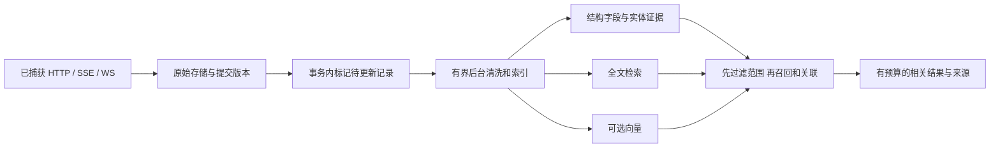

# AgentProxy：面向模型的业务调试内核与任务清单

调研日期：2026-10-25。代码基线：[`31812d1`](https://github.com/zhanyiyi/AgentProxy/tree/31812d1fcc28f8f50c5f378d46bb5945e4996e43)，分支 `codex/runtime-browser-polish`。

本文承接 [11 个项目的功能比较](COMPETITIVE_ANALYSIS.md)，重新按照产品目标筛选需求。**本轮交付是调研、设计和开发任务清单，没有实现下文待办，也没有运行新的性能、手机真机或产品功能测试。** 代码事实、历史验收记录、设计建议与尚待实测的判断分别说明。

同日补充的 [数据库与内核专项评审](DATABASE_KERNEL_REVIEW.md) 以 `cfd617e` 为基线，细化事务、正文证据、异步终态、查询计划和磁盘生命周期；两个基线之间没有产品代码变更。本文已合并发现，任务由 20 项增至 22 项。专项评审仅额外执行一次合成库查询计划观察，不是性能验收。

## 1. 产品方向与判断

AgentProxy 最值得做到顶级的细分领域是：**让模型在复杂业务操作过程中，可靠地获取浏览器与网络证据，找回业务上下文，并用可核验的事实继续处理问题。**

当前更需要提高内核质量，同时把内核的事实准确交给模型。优先顺序是：采集与执行正确性 → 有范围、有预算的观察与查询 → 业务实体和关系 → 可选语义召回。内置更多模型调用、更多工具名或者更大的工作流框架，不会自然带来这些结果。

“AI native”在这里应落实为四件具体的事：

1. 模型拿到的是有来源、有范围、有完整性标记的结果，能够区分“没有发生”“没有捕获”“尚未写入”“没有查到”。
2. 每次动作都有确定的执行状态；进程中断后，旧动作的未知结果不会被下一步覆盖成成功。
3. 查询按问题返回少量相关证据，必要时能够继续展开，避免重复让模型阅读大段流量。
4. 模型负责业务理解和步骤选择；内核负责执行、持久化、隔离、边界和可复核性。

### 1.1 明确的产品边界

- 不建立人工审批、手工接管、等待人点按钮、人工标注或拖拽编排流程。
- 浏览器里的确认框由模型通过现有 `browser_dialog` 决定；它是业务页面交互，不是产品的人在回路机制。
- 运行环境可以预先配置账号、受管设备、证书信任和访问范围。缺少运行前提时返回明确的机器状态，不能用一个永远等待人工的步骤掩盖它。
- 现有工具经过有限多步调用已经可以完成的事情，从新增功能任务中剔除。工具组合说明可以改善，但不为每条组合新增一个 API。
- 保留已经实现且有用的接口；“剔除”指不重复立项，不是删除现有能力。竞品清单仍保留事实，但不再把竞品的每个勾选项当作我们的需求。
- 本文的业务场景是功能、可靠性、状态一致性与故障定位。不会引入自动攻击计划器、漏洞利用链或第三方 App 的证书固定绕过。

### 1.2 内核与模型功能的取舍

| 方向 | 当前判断 | 具体投入 |
|---|---|---|
| 代理、浏览器执行、持久化内核 | 最高优先级；已有明确代码缺口 | 信任设置、动作覆盖、清空顺序、内存边界、查询隔离 |
| 模型观察协议 | 与内核修复一起做 | 正确的分层输出、总预算、错误语义、覆盖范围、稳定引用 |
| 业务语义索引 | 有实际增量价值 | 字段级实体、证据关系、全文查询、消息检索 |
| 向量与语义分组 | 在结构化基线上增量引入 | 改善业务说法与技术字段不同名时的召回，保留可关闭路径 |
| 内置通用 Agent / 多模型编排 | 当前不立项 | 外部模型已经承担规划，避免重复运行循环和两份状态 |
| 更多一键业务工具 | 当前不立项 | 优先补现有工具无法保证的原子性和信息完整性 |

前一轮比较里，refs、增量观察、恢复、MCP 和流量分析都已有成熟竞争者。AgentProxy 的价值应体现在浏览器步骤、网络事件、业务实体与持久证据能连续使用，而不是宣称某个单项独有。比较依据见 [已有研究的项目明细](COMPETITIVE_ANALYSIS.md#项目固定版本与详细功能目录)。

## 2. 已有能力：从新增任务中排除

| 想做的事情 | 当前已可用的路径 | 本轮处理 |
|---|---|---|
| 手机或外部客户端经显式代理采集 | CLI `--host` + `session_start_proxy_only` | 不重做“手机代理内核”；补真实诊断缺口 |
| 被动采集后挂接浏览器 | `session_attach_browser` | 不增加新的模式切换框架 |
| 分级读取流量 | `traffic_list` + `traffic_inspect(meta/preview/full)` | 修正文预算旁路，不重做摘要工具 |
| 从上一步响应提取下一步输入 | `traffic_extract` 的 JSONPath/CSS/regex、`save_as`、会话变量 | 不新增变量引擎；凭据不应重复回显 |
| 多标签页、iframe、对话框、下载 | 现有 browser 工具 | 用组合说明覆盖业务流程 |
| 页面变化后重新定位 | `browser_snapshot` → 新 ref → `browser_act` | 不增加猜测点击或不透明自愈 |
| 增量 ARIA、元素引用 | 当前 snapshot/ref 实现 | 不重复开发 |
| SSE、压缩 SSE、WebSocket 消息查询 | `traffic_messages` 与现有存储 | 不重复开发解析和消息库；处理内存与输出边界 |
| 接口模板、API 清单和 OpenAPI | 现有路径归一化、`site_map`、导出 | 修复 origin 混聚和范围问题 |
| 关联、链路、笔记、证据报告 | `traffic_link/correlate/chain`、`note_*`、`evidence_bundle` | 补字段来源与证据类别，不再建一套关系图产品 |
| 多步骤执行与业务后置检查 | 观察 → 动作 → 流量检索/字段提取 → 下一步 | 不建通用 DAG、验证 DSL 或业务动作宏 |
| 中断后读取状态与重新观察 | `browser_checkpoint`、时间线、流量库 | 修复覆盖和确认对象绑定，不另建恢复引擎 |
| 持久保存业务调查结果 | 现有 notes、links、actions、checkpoint | 不新增向量“任务记忆”来替代这些记录 |
| 图形化调试、人工登录接管、手工改包 | 与本轮目标不符 | 不纳入开发路线 |

这些能力不代表所有实现细节都已正确。下面只把其中的具体缺陷作为任务，而不是把整个能力重新写成“待实现”。依据：[工具注册][C01]、[分析与关联][C04]、[消息存储][C09]、[检查点][C06]。

## 3. 代码核对：历史问题究竟解决到哪一步

“已有”表示代码中存在对应实现；“历史验证”仅引用 [IMPLEMENTATION.md](IMPLEMENTATION.md) 中已经发生的验收，不代表本轮重测。静态发现可以确定存在相应路径，但不能替代真实负载下的影响测量。

| 领域 | 已解决或已有 | 真实剩余问题 | 任务 |
|---|---|---|---|
| 生命周期 | 启停锁、整体超时、取消清理、MCP 退出清理；默认实例目录隔离 | 不将局部修复宣传成所有平台环境都无故障；保留依赖契约验收 | K11、V01 |
| 外部 CDP 资源 | 记录资源所有权，断开时保留借用的上下文和页面 | 沿用现有设计，无新框架 | 不重复立项 |
| SQLite | WAL、连接确定关闭、busy timeout、后台 writer | 同步查询和范围下推不足；schema 缺版本与完整迁移事务；本地 SQLite 3.49.1 缺官方 WAL 修复 | K07、K11、D01 |
| 写入完成语义 | pending、dropped、write_errors 可查询；drain 包含正在写的项 | 全局计数无法说明某次查询对应哪段已提交数据；清空可被旧队列回写 | K05 |
| 普通 HTTP 正文 | 保存时截断至 256 KiB，二进制和附件有相应处理 | 完整 body 已先缓冲；快照读取 content 可能同步解压。保存限额不是峰值内存限额 | K06 |
| 流式消息 | SSE/WS 持久化和游标已有；gzip/deflate/br/zstd SSE 已有历史验证 | 单消息与单连接保留限额不控制所有解压峰值；底层 WS 历史仍会增长 | K06 |
| 输出分层 | meta/preview/full 已有 | meta/preview 仍附带完整已存请求体生成的 curl；正文别名重复；消息条数限制不等于总响应预算 | K01 |
| HTTPS | mitmproxy 生成 CA；自启浏览器有 SPKI 路径；代理上游默认验证 TLS | 浏览器 context 默认 `ignore_https_errors=True`，CA 缺失时还有全局忽略证书 fallback；信任说明过强 | K02 |
| HTTPS 故障定位 | 代理进程状态、CA 文件存在性可读 | HTTP flow 的错误字段没有完整落库；握手可能早于 HTTP flow 失败，缺连接级失败阶段 | K08 |
| 捕获范围 | 域名限制已有；PDF 等业务文件不再一概排除 | 仍按部分扩展名直接不记录，不能等同“仅忽略静态正文”；排除、截断与未观察需可区分 | K06、K10 |
| 接口聚合 | 路径模板、计数、状态分布、样本已有 | 聚合键只有 method + path，没有 origin，会混合不同站点 | K04 |
| 数据关系 | 响应值与后续请求值的匹配已有 | 默认固定取最早 2000 条；普通短业务 ID 覆盖不足；请求开始时间不能证明响应先于消费 | K04、S03 |
| 步骤恢复 | 统一导航/动作路径先保存意图，未知结果阻止盲目续写 | 旧入口覆盖不齐；checkpoint 与回执分开提交；dialog 后原动作终态未持久闭环；acknowledge 缺版本绑定 | K03、W01 |
| 文件与磁盘 | 单正文/单附件限额、附件 hash 与原子文件替换 | 整库、消息和文件总量无保留周期；缺文件引用回收及下载终态持久记录 | D02 |
| 性能和可靠性水平 | 已有功能回归记录 | 没有可据以宣称“大流量生产级”“手机普遍兼容”或“行业第一”的容量及场景数据 | V01 |

### 3.1 最值得先修的五个问题

**第一，分层读取实际上可能返回完整正文。** `get_detail()` 对 body 分层，但又用完整已存 request body 生成 `curl_command`；preview 还同时返回 body 与 body_preview。它直接增加模型上下文和凭据暴露面，不需要新算法就能改进。[C02]

**第二，HTTPS 信任要分两段看。** 代理到服务器当前继承 mitmproxy 的严格验证默认值；浏览器到代理却有宽松 context 与 CA 缺失 fallback。不能因为 HTTPS 能打开、流量能入库，就宣布证书问题已经全部解决。[C03]

**第三，业务聚合的命名空间不完整。** 不同 origin 的 `/orders/123` 可能进入同一端点组。现有自动关联使用的 timestamp 是请求开始时间，也不足以证明来源响应已经生成了消费值。先纠正事实口径，再建设语义层。[C04]

**第四，清空与后台写入缺少共同边界。** `traffic_clear` 确实清理 checkpoint 和数据库，但 writer 中已经排队的旧数据可能随后写回来。单靠 workflow 锁不能约束另一个线程的队列。[C05]

**第五，内存预算落在过晚的位置。** 最终 SQLite 保存 256 KiB，并不代表上游只分配过 256 KiB；5000 条队列也不是字节预算。需要测量并约束接收、解码、快照、排队和返回各阶段。[C07]

## 4. GitHub issue：需求与当前实现的差值

通过 GitHub REST API 对 [全部 issues](https://api.github.com/repos/zhanyiyi/AgentProxy/issues?state=all&per_page=100)、`state=closed` 和 [评论](https://api.github.com/repos/zhanyiyi/AgentProxy/issues/1/comments?per_page=100) 分页读取，排除 PR 后，截至调研时只有 **1 条 open issue，0 条 closed issue，0 条评论**。唯一条目是 [#1「新功能需求/架构方案建议」](https://github.com/zhanyiyi/AgentProxy/issues/1)，创建与最后更新时间均为 `2026-06-01T07:10:08Z`。未发布评论，也未修改 issue 状态。

| issue 中的诉求 | 当前判断 | 处理 |
|---|---|---|
| 独立 MITM、不强制开浏览器 | 已有 | 排除重复任务 |
| 局域网与外部客户端接入 | CLI host + proxy-only 可组合完成 | 排除重复内核开发 |
| MCP 动态指定 host | 当前启动工具未暴露 | 配置已可完成，暂不为参数对称性立项 |
| host、port、运行状态 | 已有 | 扩展真实连接诊断 |
| CA 路径、存在性 | 已有 | 增加指纹、有效期和实例对应关系：K08 |
| 上游代理 | 未提供 | 保留企业网络需求：E01 |
| 外部接入说明 | 已有，手机地址示例有误导 | 随 K08 修正 |
| 减少模型读取成本、聚合可回查 | 已部分实现 | 修复输出、命名空间与保留边界：K01/K04/K06 |

issue 是用户需求证据，不是当前实现的完整描述。上表的实现判断来自本轮源码核对，不能把 issue 仍为 open 当作所有条目都没完成。[C01][C04][C08]

## 5. 图片中的手机抓包，AgentProxy 能做到什么

**能接收受控手机已经发送到它的普通显式代理 HTTP/HTTPS 流量，并沿用现有 SQLite、查询和分析链路。** 网络互通、监听、客户端信任是三个独立前提。图片里的电脑热点只是实现网络互通的一种方式，不是需要加入 AgentProxy 的功能。

| 图片中的环节 | 当前能力或边界 |
|---|---|
| 电脑与手机互通 | 属于部署网络前提；不需要 AgentProxy 自建热点管理 |
| 代理监听 | `--host` 可以指定监听地址，proxy-only 无需 Playwright |
| 手机连接地址 | 应是手机可达的电脑地址；手机的 `127.0.0.1` 指手机自身，`0.0.0.0` 是监听通配地址 |
| 证书取得 | 当前安装的 mitmproxy 12.2.3 中，DumpMaster 加载默认 Onboarding，默认启用 `mitm.it`；本轮核对了实际加载链，未做真机验证 |
| 证书格式 | mitmproxy 已提供公有 CA 的 PEM/CER/P12；没有必要把证书送到图片里的在线转换网站 |
| HTTPS 明文 | 要求相应客户端真正信任当前 CA；安装文件与 App 信任是不同状态 |
| 不遵循 HTTP 代理的 App | 当前 regular 入口不会自动收到这类流量；换网络拓扑也不能保证解决证书固定 |
| 手机操作自动化 | 当前 browser 工具控制的是 Playwright/CDP 浏览器，不能据此声称可操作手机原生 UI |

mitmproxy 的 `.cer` 公有证书与其 `.pem` 公有证书内容相同，仅扩展名不同；`mitmproxy-ca.pem` 则包含私钥，不应作为设备证书分发。见 [官方证书文件说明](https://docs.mitmproxy.org/stable/concepts/certificates/)。

Android 面向 API 24 及以上的 App 默认不能仅因用户安装了 CA 就被视为信任它；自有调试构建可以声明调试 CA。iOS 手工下载的证书也不自动获得 TLS 信任，受管部署另有 Configurator/MDM 路径。见 [Android 官方配置](https://developer.android.com/privacy-and-security/security-config) 与 [Apple 官方说明](https://support.apple.com/en-us/102390)。

在“不做人为介入”的目标下，自动运行应面向**已配置的测试设备、模拟器或已有设备管理通道**。AgentProxy 提供连接事实、证书身份、失败阶段和来源查询；不把系统信任步骤伪装成可自动完成的代理功能，也不把“等待用户安装证书”加入任务执行循环。

上游 mitmproxy 的其他捕获模式可作为未来特定接入需求的参考，但 AgentProxy 当前未开放这些模式，不能把依赖项目的全量能力算到自己头上。见 [官方代理模式](https://docs.mitmproxy.org/stable/concepts/modes/)。本轮不安排全套 VPN、透明路由、手机管理平台或 App hook 开发。

## 6. 已捕获流量的清洗、语义关系、向量和聚类

### 6.1 可以做，但需要明确三种不同的关系

| 关系 | 例子 | 可以说明什么 |
|---|---|---|
| 字段与实体联系 | 创建响应中的 `order_id=123` 与查询请求的订单字段相同 | 在指定业务域、实体类型和来源范围内存在值联系 |
| 执行或时间联系 | 某次点击附近出现请求；某响应结束后才出现后续请求 | 提供步骤候选和先后证据；不自动证明唯一因果 |
| 语义相似 | “导出任务”“生成报表”“export job” | 帮助召回同主题数据；不证明是同一个任务实例 |

真正需要的不是把所有流量向量化后做一次大聚类，而是让模型能问：“这个导出任务从创建到下载发生了什么？”系统返回相关实体、消息、请求与差异，并说明每条记录为何相关。

### 6.2 最小数据路径



复用现有 SQLite、writer、flows、stream_messages、flow_links、actions 和 notes。新增的只是必要的派生索引、实体引用与待更新状态。初期不引入外部向量数据库、图数据库、消息总线或另一个在线规划服务。

### 6.3 清洗与保留规则

1. **原始记录与派生视图分开。** 清洗结果服务检索，不修改已存证据。当前已被截断或排除的内容无法事后恢复；索引也必须保留这个限制。
2. **先确定来源范围。** 至少包含采集实例/代际、origin；context/profile、连接来源、设备标签按已知事实补充。跨站点业务可显式查询选定 origin 集合，不能默认把所有站点揉在一起。
3. **按结构拆分。** HTTP 保留方法、路径词、字段名、类型、状态和错误描述；SSE/WS 以消息为证据单位。长数组只保留有界样本和数量，HTML 去展示噪声但保留字段来源。
4. **敏感值不进入默认模型视图和 embedding。** Authorization、Cookie、密码、密钥、个人字段需要脱敏；URL、错误文本、笔记和嵌套字段也在范围内。低熵业务 ID 如需相等匹配，使用本地密钥生成的范围内稳定替身，不能仅做可枚举的普通哈希。检测规则无法保证识别任意秘密，外部 embedding 默认只接收配置允许的字段投影；未定义处理策略的自由文本省略并标记。
5. **脱敏不是不可逆匿名化。** 原始数据仍按本地捕获保留策略管理；默认返回掩码和来源引用。显式读取必要原值可以继续使用现有接口，不增加人工审批流程。
6. **噪声降权而不虚构消失。** 心跳、相同状态轮询和重复成功请求可在视图内折叠，保留计数、首末时间、状态变化、异常样本以及成员引用。
7. **不完整数据不能被补成完整事实。** 截断 JSON、缺失响应、未知编码、超限消息都标明；不让语言模型猜补后再当作索引事实。

### 6.4 业务实体与字段级证据

先覆盖常见业务对象和异步任务，而不是设计一个无限本体：订单、申请、工单、报表任务、文件等，由字段名、类型、所在路径和选定业务域共同确定。短 ID 也要支持；单独的 `123` 不足以建立联系。

建议的最小来源结构如下，字段名是设计草案：

```json
{
  "capture_generation": 7,
  "flow_id": "flow-a",
  "message_id": null,
  "side": "response",
  "field_path": "$.data.order_id",
  "content_version": "hash-of-observed-content",
  "entity_type": "order",
  "value_ref": "scoped-stable-reference",
  "evidence_kind": "field_equality"
}
```

关系中记录两端来源、规则版本和关系类别。模型写入的业务解释标为 `model_inferred`，时间邻近标为 `temporal_candidate`，值相等标为 `field_equality`；不要用一个看似精确的“置信度 0.97”混合三种含义。

没有响应到达时间时，不能声称“响应生产了后续请求的值”。真实的跨域业务关联可以存在，但应保留两端 origin，并由显式范围及字段证据支持。对于 SSE/WS，必须能够定位具体 `message_id`，不能只引用一条持续数小时的连接。

### 6.5 增量索引的关键约束

当前 flows 的主键是 UUID，同一 flow 会被 UPSERT；timestamp 是请求开始时间。因此 **`MAX(timestamp)`、最大 rowid 或“上次见过这个 flow_id”都不能正确捕获所有更新**：长请求晚落库、SSE 响应头与结束更新都会漏掉。[C09]

最小方案是在原始记录提交的同一事务中更新该对象的 dirty 状态和内容版本。后台有界批处理读取已提交记录，写入派生结果前检查版本和采集代际；旧任务不能覆盖新结果。流消息可沿用现有自增消息 ID，再与所属采集代际、索引版本共同判定。

每次查询返回“原始数据已提交到哪里”“索引处理到哪里”“还有多少待处理或失败”。索引滞后时，结果标为不完整或退回显式的原始范围查询，不能把暂未入索引的记录说成不存在。清空和删除同步失效派生数据；索引重建不要求再次访问业务系统。

不为来源引用建立无界历史正文库。原始 flow 更新后，旧引用无法匹配内容版本时返回 `source_changed`；已清除或未保留时返回 `source_unavailable`，关联派生结果失效或重建。核验记录保留当时的版本和结论，并注明目前能否回查，不能拿当前正文冒充旧证据。

### 6.6 检索与聚类的实施顺序

**第一步：结构化范围与准确值查询。** origin、方法、状态、时间、来源、实体类型和实例引用先过滤。准确订单号查询不能被语义分数淹没。

**第二步：全文检索。** 索引清洗后的字段名、路径词、状态、错误信息和有界业务文本。SQLite FTS5 已提供 BM25 和文本片段能力，适合当前单机架构；要核对随 Python 分发的 SQLite 是否包含 FTS5。中文短词与 camelCase 字段需要明确切分策略，不能假设默认分词足够；trigram 也不能覆盖所有少于三个字符的查询。见 [FTS5 官方文档](https://www.sqlite.org/fts5.html)。

**第三步：可选向量召回。** 编码清洗后的端点/事件业务卡片，按内容 hash、清洗版本、模型与维度缓存。端点相似描述可以去重编码，业务实例关系仍由结构化索引维护。初期在限定范围的小规模集合上做简单向量检索；只有容量数据证明需要，再选 ANN 或独立存储。

向量可以改善“订单撤销”和 `cancelPurchase` 这类说法差异；它不会修复被截断的证据，也不会自动识别所有业务依赖。默认使用本地处理；若配置外部 embedding 服务，只发送已清洗字段，说明数据目的地、模型版本和消耗。查询文本同样需要处理。关闭服务或达到预算后，结构化和全文查询继续可用。

**第四步：混合排序。** 精确实体命中单列优先，其余文本和向量候选可用 RRF 合并，不直接相加数值尺度不同的分数。RRF 是可解释的起点，不是提升保证。见 [算法说明](https://www.elastic.co/docs/reference/elasticsearch/rest-apis/reciprocal-rank-fusion)。

**第五步：按查询分组。** 优先提供“同一业务实体”“同一端点模式”“语义近邻”三种分组。结果包含组依据、代表记录、数量、变化和成员分页。一个流程可属于多个主题；语义组是查询视图，不应被写成确定业务链。低相似项可以不归组，不做强制全库聚类。

### 6.7 模型最终得到什么

问题示例：**“刚才创建的导出任务为什么没有下载结果？”**

返回应包含：选定的来源范围；任务实体；创建请求；可关联的轮询或消息；当前状态；缺失或失败阶段；少量代表证据；完整性标记；下一页/进一步展开引用。每条关联说明来自准确字段、时间候选还是语义召回。

结果不能只给一句“这些请求高度相关”，也不能把所有可能相关的正文一次性塞给模型。建议的响应预算以 UTF-8 字节数约束；token 数只能是指定 tokenizer 下的估计，不能声称不同模型都精确相同。

## 7. 复杂多步骤交互：让现有工具更可靠地组合

### 7.1 外部模型的执行循环

```text
读取页面、checkpoint 和相关流量
→ 明确当前业务对象与本步目标
→ 用现有 browser 工具执行一个动作
→ 读取动作回执与已提交的候选证据
→ 用现有查询/提取检查业务后置状态
→ 记录必要证据并选择下一步
```

这条循环现在就能组合出来，不立项新执行器。动作原语完成与业务成功仍是两种状态。新增工作的重点是：步骤覆盖一致、来源范围稳定、证据读取没有隐性遗漏、未决结果能绑定到具体动作。

### 7.2 四个代表性场景

| 场景 | 现有组合如何处理 | 真正需要的底层改进 |
|---|---|---|
| 创建业务单据 → 查询详情 → 修改 → 确认状态 | snapshot/act、traffic_search/extract、notes | 短实体 ID、字段来源、准确范围，避免同名接口混聚 |
| 提交导出 → 异步处理 → SSE/WS 通知 → 下载 | 现有动作、messages、downloads、字段提取 | 将具体消息与任务实例相连；区分仍在处理、消息未入库和已超限 |
| 提交后进程中断，重启继续 | checkpoint、重新观察、查询已存在单据、acknowledge | 确认绑定旧动作版本；记录核验依据；不得因重启自动再次提交 |
| 移动端产生事件，桌面模型定位状态不一致 | proxy-only 捕获、现有查询与业务浏览器 | 连接来源、业务域、时间与实体关联；不能把 IP 直接当账号或设备身份 |

复杂性来自跨界面、跨连接、异步完成、对象状态变化和执行不确定性。为每种行业业务新增专用动作，并不能普遍解决这些问题。

### 7.3 无人在回路的恢复语义

当前 `needs_review` 表示动作结果待核验，不要求某个人审批。文档应使用“待核验”，由模型观察现有页面、流量和业务结果后决定下一步。[C06]

建议保留三个不同状态：

- `not_started`：动作未开始，例如旧 ref 被拒绝；重新观察后可以发起新动作。
- `completed`：浏览器原语完成；业务后置条件仍由模型核对。
- `unknown`：可能已经发生副作用；先查询业务结果，不能通过盲目重试消除不确定性。

已经发生的未知结果不能靠一个“继续”调用变成成功。模型在证据充分时记录核验结论及来源；缺乏证据时维持 unresolved，并返回明确原因。达到查询预算仍不确定，任务可以以“无法判定”结束；这是一种正确终态，不是人工接管请求。

核验本身通过现有多步工具完成。W01 只补确认对象的稳定绑定与核验记录，避免两次调用之间状态变化导致确认了另一条动作；不会新增自动重放、通用后置条件语言或隐藏 LLM 决策链。

## 8. 开发任务总表

以下 **22 项**均为待开发或待验证任务。P0 表示当前会影响结果可信度的明确合同或依赖问题；P1 表示建立可用产品基线所需；P2 为完成前置后按收益纳入。规模 S/M/L 仅表示相对改动量，不是工期承诺。

| ID | 优先级 / 规模 | 任务 | 依赖 |
|---|---|---|---|
| K01 | P0 / M | 修复分层输出，建立整条响应预算 | 无 |
| K02 | P0 / M | 明确并收紧浏览器 HTTPS 信任与环境语义 | 无 |
| K03 | P0 / M | 所有相关浏览器变更入口接入同一动作合同 | 无 |
| K04 | P0 / M | 修复业务域混聚及关系证据口径 | 无 |
| K05 | P0 / L | 捕获提交版本、清空顺序与采集代际一致性 | 无 |
| K06 | P1 / L | 接收、解码、排队、长连接保留的资源边界 | V01 基线；与 K05 对齐 |
| K07 | P1 / M | 查询移出事件循环，范围与分页下推 | K04、K05 |
| K08 | P1 / M | 连接/TLS/CA 的机器可读诊断 | K02 |
| K09 | P1 / M | 外部来源记录与可查询范围 | K04、K05 |
| K10 | P1 / M | 统一错误、覆盖和完整性结果 | K01、K05、K07 |
| K11 | P0 / S | 修复实际 SQLite 运行时版本缺口，明确依赖契约 | 无 |
| D01 | P1 / M | schema 版本与原子、可重试迁移 | 无 |
| D02 | P1 / M | 整库/文件保留、空间计量与下载终态 | D01、K05；与 K06 对齐 |
| S01 | P1 / M | 有来源的清洗视图与默认脱敏 | K01、K04、K10 |
| S02 | P1 / M | 可重建、可恢复的增量派生索引 | K05、S01 |
| S03 | P1 / M | 业务实体及字段/消息级关系 | K04、K09、S02 |
| S04 | P1 / M | 扩展现有搜索：准确值、全文与关系展开 | K07、S02、S03 |
| S05 | P2 / M | 可选向量与混合排序 | S01、S02、S04、V01 |
| S06 | P2 / S | 相关结果分组与有界业务摘要 | S03、S04；语义分组依赖 S05 |
| W01 | P1 / M | 未决动作的机器核验记录与条件确认 | K03、K05、K10 |
| E01 | P2 / M | 企业网络的上游 HTTP(S) 代理 | K08 |
| V01 | P1 / M | 一套固定容量与业务证据基线 | 分阶段使用，不阻塞文档交付 |

下面给出每项的开发边界和完成标准。涉及 schema 变更的任务先完成 D01。每项实现都应同步更新工具说明与 README 中相应承诺；不单独建立一个长期“文档同步工程”。

### K01 — 修复分层输出，建立整条响应预算

- **依据：** `traffic_db.get_detail()` 的 curl 旁路与重复正文；`traffic_messages` 最多可一次请求 1000 条，每条又可能达到 64 KiB。[C02][C09]
- **最小实现：** meta 查询不加载正文；默认模型视图只保留一份正文与一种头表示。cURL、原始有序头、原值按显式选项展开。列表、消息、提取和证据输出使用整条响应的字节预算，并返回可继续读取的位置。URL、头、变量设置结果同样计入预算。
- **组合调用无法解决的部分：** 调用者已经选择 meta，但服务端仍在其他字段返回整段 body；只有修复序列化合同才能消除此旁路。
- **兼容：** 旧别名可留兼容路径，正常响应不同时输出两份内容；精确字节预算与估计 token 字段分开。
- **验收：** 一个带长正文、长 URL、重复头和凭据的固定样本；meta 大小不随正文增长，preview 只有一份内容，消除 cURL 正文旁路及已知凭据字段回显，分页合并无重复/遗漏。完整业务文本脱敏由 S01 验收。超大的单消息可通过引用及分段展开，不因裁剪损坏 JSON。

### K02 — 明确浏览器 HTTPS 信任与环境语义

- **依据：** `ignore_https_errors=True` 与 SPKI 启动参数同时存在；CA 缺失时全局忽略证书；启动还默认关闭部分站点隔离特性。[C03]
- **最小实现：** 明确代理上游验证、受控浏览器到代理信任、借用 CDP 浏览器状态三者。受控浏览器默认使用当前 CA 的限定信任路径，CA 未就绪时返回明确状态，取消隐式宽松退化。去掉没有明确产品必要性的默认站点隔离修改；显式特殊配置必须体现在状态中。
- **边界：** 不擅自改借用浏览器的系统信任；不通过关闭校验来声称证书问题已解决。测试环境的显式非默认选项不代表正常 HTTPS 验证结果。
- **验收：** 一组本地可信/不可信证书场景，分别验证两段 TLS；CA 缺失不能静默切换到全局忽略，状态准确反映有效设置。借用浏览器不被改写。

### K03 — 浏览器变更入口使用同一动作合同

- **依据：** `browser_execute_js/go_back/go_forward/reload` 直达 BrowserController，绕开统一检查点路径。[C06]
- **最小实现：** 复用 SessionManager 的执行边界；动作开始前分配并持久化稳定 action_id，执行后更新同一动作。逐项核对浏览器状态变更入口，明确哪些属于业务执行、哪些只是会话配置，不能靠旧入口绕开未知结果保护。
- **事务与异步终态：** 回执和 checkpoint 完成在同一 SQLite 事务提交；开始前意图仍立即等待提交，不能仅排队。dialog 解除后，原 task 仍 pending 就保持未决，由完成通知按原 action_id 更新持久终态；再次弹框仍可处理，不能持有工作流锁等待原 task。迟到通知匹配采集代际和动作版本，不能覆盖已推进的 checkpoint。明确意图对进程崩溃和系统掉电的不同保证；若承诺掉电持久性，关键提交使用相应同步等级。依据见 [专项评审](DATABASE_KERNEL_REVIEW.md#22-动作回执与检查点完成必须一起提交)。
- **JS 语义：** 任意脚本可能有副作用；内核不尝试用字符串判断脚本是否只读。无法判断的执行中断保留 unknown，不能标成未开始。
- **组合调用无法解决的部分：** 外部模型无法原子地替工具完成“先写意图、再执行、再写结果”，也无法覆盖进程恰好中断的窗口。
- **验收：** 参数化覆盖上述四个旧入口；在执行前拒绝、执行中取消、执行完成三种边界得到正确状态，同一 action_id 可在回执与 checkpoint 中查询。
- **新增验收边界：** 本地提交中断不留下相互矛盾的完成记录；对话框解除后的迟到成功/失败更新原回执，不启动第二份动作。不为此构造远端重复提交或故障利用流程。

### K04 — 修复命名空间与关联证据口径

- **依据：** 接口 key 缺 origin；现有关系以请求开始时间表达先后，来源字段路径缺失。[C04]
- **最小实现：** 端点身份使用 origin + method + normalized_path。现有值关联加明确范围和覆盖说明，把值相等、时间候选与因果断言分开；新增可用的请求/响应时间字段时保留其真实含义，不伪造旧记录缺失值。
- **复用：** 继续使用现有聚合、flow_links 与链路接口。跨域链可以查询，但必须显式指定相关域和来源证据。
- **验收：** 两个 origin 的相同路径不合并；相同短 ID 不同类型不自动串链；源请求先开始但源响应晚到的样本不被标为已证明的数据生产关系。旧记录的缺失时间显示 unknown。

### K05 — 提交版本、清空与采集代际一致性

- **依据：** writer 排队与 `clear_capture()` 不共享顺序边界；flow 可多次 UPSERT；现有全局计数不足以绑定查询结果。[C05][C09]
- **最小实现：** 在现有 writer/SQLite 内实现有序清空控制与持久采集代际。原始写入有提交版本，查询返回当前代际及可见版本；排队、提交、失败、丢弃各自记录，不能用“最大处理序号”推断中间从未丢数据。
- **明确清空合同：** clear 内有一个原子的代际切换点，完成返回表示清空已提交。切换前已开始的 HTTP flow 和 SSE/WS 应用流继续转发，但后续写入不进入新代际；状态明确说明这些旧流已停止采集。切换后的新 HTTP 请求正常记录，包括复用原 keep-alive/TCP 连接的请求。这样不必在压缩流中途重置解码状态，也不会把清空前半条事件拼回新历史。
- **一致性：** 旧队列与旧派生任务不得回写；checkpoint、动作、消息、关系及派生索引按同一清空边界处理。文件保留策略单独声明，不能把数据库清空说成物理文件销毁。
- **所有权与引用：** 同一库只允许一个活动 AgentProxy 实例管理 checkpoint；显式路径复用历史不代表支持多个实例同时恢复。首条消息入库时保证父元数据可见，或说明父来源缺失。tag/note/link 在同一事务验证来源及代际，之后才对生命周期明确的关系增加外键；不机械加 FK 导致有效消息丢失。
- **验收：** 一个可控暂停 writer 的场景：clear 返回后旧记录不复活；旧 SSE/WS 流保持正常转发但不写新代际；新请求可查询，包括同一 keep-alive 连接的新请求。重启沿用代际，旧游标不能悄悄读成新数据。

### K06 — 接收、解码、排队与长连接的资源边界

- **依据：** 完整 content 在快照时已读取，最终存储才截断；队列按条数；mitmproxy 保留 WS 消息历史；压缩库可能一次产生较大解码输出。[C07]
- **最小实现：** 为接收正文、观察解码、队列和返回各自定义可观测的字节限额。普通大响应采用有界观察/附件策略；队列只持有有界数据或文件引用。达到 SSE 保留预算后停止不再需要的解析；在确认上游插件契约后释放已消费的 WS 历史。
- **采集选择：** 域名范围与正文保留分开。范围内业务请求不能只因扩展名就消失；可保留元数据和省略原因，再按内容类别决定正文预算。既有排除策略要明确显示为 excluded。
- **完整性：** 不修改透传字节。需要完整正文的既有规则路径与流式保留策略必须明确兼容范围，不能静默跳过规则。底层库若无法严格限制单次解压分配，应如实公布剩余峰值边界。
- **先保元数据：** 普通 HTTP 的 `.content` 解码失败不能丢弃整份响应快照。保存状态、头和解码结果；请求/响应共享简明正文描述，区分解码字节、文本投影和未保留正文。现有 size 不能当线上字节；记录可观测量，未知量不填成 0。该正确性修复优先于解压性能优化。
- **验收：** 一次本地混合大 body、压缩 SSE、长 WS 场景，验证转发一致、内存/队列有界策略生效、超限原因可查。没有测量前不承诺固定倍数提升或所有负载零丢失。

### K07 — 查询执行与范围下推

- **依据：** `traffic_list/inspect/search` 仍同步访问 SQLite；聚合和 site_map 先全库 fetchall 后过滤；关联固定取最早一批。[C10]
- **最小实现：** 在现有异步工具边界统一卸载同步 DB 工作；SQL 先筛范围和投影，再分页或有界聚合。增加必要的 origin、时间、来源索引；按实际查询计划决定，不先建设连接池或替换数据库。
- **已有依据：** [一次合成库查询计划](research/database/query-plan-evidence.json) 显示 domain 函数过滤仍扫描时间索引，method 过滤另做排序，按 flow 的消息游标已经使用合适索引。候选组合索引只证明特定查询形状可用，不是性能提升结论。评估写线程独占连接复用；仅当容量测量证明确有必要时，才增加短且有界的批量提交，动作前意图不等待凑批。
- **查询合同：** 保留稳定排序与游标，说明扫描范围、可见提交版本及是否已到末尾。查询提供当前增量视图；影响结果的更新导致游标失效时明确返回 `cursor_stale`，不承诺还原 UPSERT 前的历史快照，不新增历史 MVCC 库。聚合如受预算限制，必须返回 partial 与覆盖信息。
- **验收：** 一份预置库同时包含新旧流量、多 origin 和大正文；限定查询不加载范围外正文，新记录不会永久落在最早 2000 条之外。一次阻塞边界检查确认等待 SQLite 不拖住事件循环。

### K08 — 接入、TLS 与 CA 诊断

- **依据：** cert_status 有路径和存在性，没有 CA 身份；proxy_error 是进程状态，不等于连接握手失败；HTTP flow 错误未完整保存。[C08]
- **最小实现：** 扩展现有 session_status/cert_status，返回有效监听地址、设备可达候选地址、CA SHA-256/有效期/subject/issuer、当前实例与 CA 路径关系。保存有界的连接失败事件：客户端连接、客户端 TLS、上游连接/验证、HTTP 解析等阶段。
- **HTTP 终态：** 同时保存已有 flow.error 与观测生命周期；没有 status_code 不能同时表示仍等待、连接失败和已中断。连接级错误与已有 flow 的错误使用可关联的来源，避免记录两份互相矛盾的终态。
- **事实边界：** 本地候选地址不保证远端可达；零流量不证明 CA 不被信任；对端关闭也不必然是证书固定。只把观测到的错误映射为确定结论，其余保留候选原因。
- **交付：** 修正 README 手机 `127.0.0.1` 示例和工具中的旧接口名，使用当前公有证书文件，不新增证书下载服务或手工配置 UI。
- **验收：** 本地连接失败和 TLS 失败各一个确定性场景；状态能区分阶段。受管设备接入验收单独记录平台和版本；未做真机时不能写“手机验证通过”。

### K09 — 外部连接来源与查询范围

- **依据：** 当前 profile_label 主要来自受控浏览器标记，不能直接表示手机设备或真实业务身份。[C11]
- **最小实现：** 保存观测到的连接 ID、对端地址和采集实例；允许已有受管环境提供声明的 device label，并同时记录其来源。查询范围可以使用这些字段，业务账号仍按实际可验证字段表达。
- **隔离：** NAT、共享代理、地址变化和多账号意味着 IP 不等于设备、设备不等于用户。来源未知时保留 unknown，不能自动归入 default 用户。
- **不扩张：** 不建设手机管理平台、不自动识别应用包名、不增加原生手机 UI 控制。
- **验收：** 两个外部客户端同时向同站点请求时可按连接来源查询；共享地址不被断言成同一设备，浏览器 context 和外部来源不混用。

### K10 — 统一错误与证据完整性结果

- **依据：** 部分工具已使用 ToolError/dict，另一些仍把 `Flow not found` 等文本当普通成功结果；默认过滤和截断分散在不同接口。[C01][C02]
- **最小实现：** 在现有 MCP 工具外层统一结构化结果。核心字段为 status、data、scope、completeness、next_cursor、evidence_refs；工具执行失败与查询无命中分别表达。旧格式兼容在边界完成，不在核心到处做重复判断。
- **内部读取也保留事实：** `get_all_for_analysis/get_by_ids` 必须传递现有截断、省略、字符集、解码与消息来源状态。统一小型正文投影，同时说明记录在修改规则前后的观察点；不能到 MCP 外层才添加一份无法核实的完整性说明。
- **完整性至少区分：** not_observed、excluded、pending_persistence、stored_truncated、query_limited、index_pending、failed。只有确有对应事实才返回原因，不能从空结果推测原因。
- **模型操作：** 用枚举和简短说明表达可继续读取或重新观察；不在响应里新增冗长说明书或隐藏动作建议执行器。
- **验收：** 固定的正常、无命中、不存在、截断、尚未提交和索引滞后结果可被程序区分；实际 MCP 序列化也检查一次，不能只检查 Python 字典。参考 [MCP tools 的结构化结果与错误合同](https://modelcontextprotocol.io/specification/2025-11-25/server/tools)。

### K11 — SQLite 运行时与依赖契约

- **依据：** 当前依赖范围较宽；原生 AI refs、连接清理等涉及版本相关行为，已有研究也显示上游 API 会变化。[C12]
- **优先修正：** 本地实查 Python 3.12.10 / SQLite 3.49.1。SQLite 官方 WAL-reset 修复在 3.51.3 及以后，并有 3.44.6/3.50.7 回补；当前版本不包含修复。项目使用 WAL 和多连接，优先选择含修复的实际运行时，不做故障利用或损坏复现。版本事实与来源见 [专项评审](DATABASE_KERNEL_REVIEW.md#44-本地-sqlite-版本需要先更新)。
- **最小实现：** 记录实际支持的 Python、SQLite、Playwright、mitmproxy、MCP 组合和安装方式；内部接口访问集中到已有边界，采用经过验证的约束或锁定文件。SQLite 随运行时/系统库提供，不能认为更新 PyPI 依赖就完成升级。升级才触发相应契约验收。
- **不扩张：** 不为所有历史版本写兼容分支，不提前建设多浏览器后端抽象。
- **验收：** 一个声明支持的干净安装记录实际 `sqlite3.sqlite_version` 并确认包含修复，完成初始化、snapshot/ref、代理消息与退出清理；版本不兼容的提示定位到依赖，不让模型误以为业务网页坏了。

### D01 — schema 版本与原子迁移

- **依据：** 当前 user_version 为 0，ALTER TABLE 广泛忽略 OperationalError；findings 迁移的 CREATE 在隐式 DML 事务之前，失败可能遗留中间表。详情见 [专项评审](DATABASE_KERNEL_REVIEW.md#21-迁移需要成为可重试的原子操作)。
- **最小实现：** WAL 配置后显式开启迁移事务，以 `PRAGMA user_version` 管理少量顺序升级；版本 0 识别支持的旧 schema，checkpoint 表纳入同一管理。用 schema 查询判断字段存在，真实失败明确报告。
- **历史恢复：** 对已存在的迁移中间表核对已知结构与内容，给出确定恢复路径；不先删表再赌旧数据完整。后续 origin、版本和索引变更复用此路径，无需 Alembic 或通用迁移框架。
- **验收：** 一组支持的旧 schema 样本及一个受控中断边界；升级后内容与约束正确，重复启动不重复迁移，失败不会遗留新半成品状态。无需对真实抓包库做破坏性试验。

### D02 — 磁盘保留与文件终态

- **依据：** 单项限额不能约束总量；clear 保留文件；附件先写文件再提交 DB；下载最终状态主要在内存。详情见 [专项评审](DATABASE_KERNEL_REVIEW.md#27-磁盘生命周期需要独立于单条限额)。
- **最小实现：** 在现有状态接口展示 DB/WAL/附件/下载占用及可回收空间，明确总预算与保留策略。按 flow、消息和引用整体处理，当前仍在写入或被步骤使用的记录有清楚的保留边界；达到预算明确记录停止保留原因。
- **文件清单：** 记录必要的来源、相对路径、大小、hash 和状态；下载迟到终态持久更新，重启后可查询。清理仅针对当前实例受管目录内经引用核对的文件；数据库清空与文件删除分开表达，不暗改现有 clear 合同。
- **不扩张：** 不建设对象存储、自动上传归档或全事件溯源；不在每次 DELETE 后 VACUUM。
- **验收：** 一个小预算合成样本覆盖达到限额、失去引用和下载完成后重启；占用与状态可解释，活动引用不被误删，实例目录外文件不受影响。沿用固定样本，不反复填满真实磁盘。

### S01 — 有来源的清洗视图

- **依据：** 当前有字段名标签、提取与原始流量；没有面向索引的统一清洗与脱敏投影。[C13]
- **最小实现：** 纯函数式地把一条 HTTP/应用消息变成有界业务卡片，保留字段路径、内容版本和省略状态。先覆盖 JSON、表单、文本及已有 HTML 提取；不接入通用文档解析平台。
- **输入合同：** 使用 K10 的统一内部投影，保留请求/响应方向、观察点和正文表示；已解码或被替换字符的文本不能被描述为原始线上报文。
- **脱敏：** 按第 6.3 节处理秘密、个人字段与范围内稳定替身；原始记录不被改写。禁止把原始 cURL、Cookie 或完整 URL query 绕过清洗塞入向量文本。
- **验收：** 同一固定样本重建结果稳定；嵌套秘密、URL 参数、中文字段、短 ID、超大数组和截断 JSON 均有明确处理。默认视图和 embedding 输入无测试秘密原值。

### S02 — 可恢复的增量派生索引

- **依据：** flows 可更新，timestamp 不代表提交和修改时序；消息有自增 ID。[C09]
- **最小实现：** 原始提交事务标记 dirty；现有进程中的有界后台任务构建派生数据，使用 generation + content_version + index_version 保证幂等更新。失败保留原因和待更新记录，重启可继续，不启用无限重试。
- **版本处理：** 重新清洗、换模型或源记录变化只重建受影响内容。旧版本结果可标 stale，但不得混合不同向量维度或冒充最新结果。
- **派生结果：** 现有被动分析复用同一结果语义，记录 success/partial/failed、实际持久条数、规则版本和范围；当前内部吞掉异常及保存失败仍累加计数的问题必须消除。采集提交完成与派生完成分开；仅在引入本任务时复用有界派生执行路径，不另建一套调度器或扩展分析规则。
- **验收：** 旧 flow 更新、长请求晚到、流消息追加、worker 中断和 clear 各由同一组固定数据验证；重复处理不重复索引，旧任务不回写新代际，进度可查询。

### S03 — 业务实体与字段/消息关系

- **依据：** 现有关联只覆盖特定长 token；flow_links 没有字段级来源；参数标签不等于实体实例。[C04][C13]
- **最小实现：** 从结构化字段建立少量可扩展实体类型；关系附带两端字段/消息引用、范围、证据类别和规则版本。复用 flow_links 展开链路，保留原有手动链接来源。
- **现有链路修正：** 节点访问去重与输出边去重分开，保留同一对节点的不同 relation 及菱形路径；增加节点/边总预算，深度限制不能代替返回量限制。先修已有查询，不引入图数据库。
- **合理限制：** 共享状态码、空字符串、普遍出现的值不建立强实体联系；自然语言名称相近只是候选。模型补充的业务解释不能覆盖原始观测。
- **验收：** 同一测试订单的创建/查询/状态消息可关联；不同域、不同实体类型或不同实例的相同短 ID 不被误合并；每条关系均可回到两端来源。

### S04 — 结构化、全文与关系查询

- **依据：** 当前 keyword 搜索是 URL/body 的 LIKE；缺自然业务文本的索引召回与统一来源展开。[C10]
- **最小实现：** 扩展现有 traffic_search；精确实体过滤 + 清洗文本 FTS5/BM25 + 有界一跳关系展开。沿用 traffic_inspect/messages/chain 做详情，不再增加平行的一整套工具。
- **结果：** 返回匹配字段、命中片段、相关理由、来源引用、覆盖范围和游标。中文短词与技术字段使用固定样例确定分词行为；FTS 不可用要明确能力状态。
- **验收：** 查询集覆盖准确 ID、中英文业务别名、错误文本、长连接消息和跨域显式范围。返回范围之外记录的数量必须为零；无向量时已具备可用检索。

### S05 — 可选向量与混合排序

- **前提：** S04 已有可比较基线。只有业务查询确有词面召回不足，才进入实现与效果验收。
- **最小实现：** 一个 embedding 接口、内容 hash 缓存、模型/维度版本、有界候选集合及 RRF。编码服务配置与外部调用预算可查询；默认不把数据发往未知服务。
- **缓存键：** 内容版本、清洗版本和 embedding 模型版本一起参与；query 与 document 的编码方式按选定模型契约处理。不开启云端也必须能使用整个产品。
- **验收：** 固定查询集比较 lexical-only 与 hybrid 的相关记录召回、误混入、时延、存储及费用。准确 ID 不退化，语义问题有实际增益才作为推荐配置；失败或停用 embedding 不影响原始采集和全文检索。

### S06 — 查询结果分组与业务摘要

- **依据：** 已有接口模板聚类；新增价值是对“当前问题相关的记录”按业务实例与证据分组。
- **最小实现：** 在现有 site_map/chain/search 的结果形状中提供实体组、端点组、语义近邻组。每组有依据、成员数量、首末时间、关键状态变化和成员分页，默认不复制成员全文。
- **边界：** 实体组保持可重复的实体标识；语义近邻组可以随查询变化，不承诺稳定业务身份。不要求流量只能属于一个组。
- **验收：** 对同一异步任务，重复轮询折叠后仍能看到状态改变与失败；不同任务的相似流量不会被说成同一实例；模型可展开所有已保留成员。

### W01 — 机器核验记录与条件确认

- **依据：** 现有 acknowledge 刷新当前上下文状态，没有绑定特定动作版本；未知业务结果本身仍被保留。[C06]
- **最小实现：** 复用 actions/checkpoint，确认时带 expected_action_id/checkpoint_version，并附业务核验结论和已存在的 evidence_refs。内核验证引用有效性、范围、版本及操作对象，业务判断由调用模型作出。
- **关键语义：** 允许开始新一步与“旧业务操作成功”分别记录。证据不足可以维持 unresolved；不伪造确定结果。确认只是持久记录，不能触发隐藏重放。
- **为什么仍值得开发：** 观察 → note → acknowledge 已能由模型多步完成，但无法原子保证中间动作状态没有变化，也无法阻止错误确认另一个新动作。
- **验收：** 提交中断后，模型用已有查询查到业务结果，再记录核验；过期版本确认被拒绝，旧 unknown 不被错误改成成功，没有任何自动二次提交。没有证据时正确保留 unresolved。

### E01 — 企业网络上游代理

- **来源：** issue #1 的真实剩余接入需求；当前 Options 仅传 host/port，没有上游模式。[C08]
- **最小实现：** 增加单一上游 HTTP(S) 代理配置，凭据在状态输出中掩码，沿用 mitmproxy 能力；明确本地监听、客户端连接地址和上游地址，避免自环。生效配置在现有 status 可读。
- **边界：** 暂不扩展 SOCKS、全平台透明转发或所有代理模式；没有企业网络场景时排在语义基线之后。
- **验收：** 一条本地受控上游链路，能区分上游不可达、认证失败和目标站点失败；直接模式保持原有行为。不得以关闭上游 TLS 校验作为默认适配办法。

### V01 — 一套固定、可复用的验收与容量基线

- **目的：** 给“更好用、更可靠”的判断提供证据。现阶段没有运行数据支撑吞吐倍数或竞品排名。
- **固定业务样本：** 一个自有本地业务 fixture 包含创建/查询/修改、异步任务、SSE/WS、下载、两个 origin、两个连接来源和一次步骤中断。配一份可直接载入的流量库，检索验收不反复访问网站。
- **容量样本：** 小响应、大响应、压缩流、长连接、并发查询混合；记录实际软硬件、依赖版本、数据规模与持续时间。每个相关阶段执行一次，只有代码改变或真实失败才复验受影响部分。
- **结果指标：** 采集写入滞后、队列峰值/字节数、丢弃与失败、查询 p50/p95、事件循环延迟、进程峰值内存、磁盘增长、输出字节与引用可回查率。
- **语义指标：** 固定标注来自 fixture 已知业务对象，记录 recall@k、无关实例混入、范围串漏及来源有效性；不能把向量相似度当准确率。不安排人工日常标注闭环。
- **完成标准：** 发布一份可复现测量记录，明确已经验证和没有验证的平台/负载。若瓶颈确实是逐条事务，再局部引入小批写入；不能把预想优化当已测收益。

## 9. 交付顺序与停止条件

### 第一阶段：可信的内核与结果

先核对并完成 K11 的 SQLite 运行时修复；D01 先于后续 schema 变更。K01/K02 可独立推进，K03 优先解决提交原子性与 dialog 终态；接着补 K06/K08 的元数据可靠性及 K04/K05/K10 的证据一致性，再完成 K07/K09/D02 与 W01。V01 在相关修改前建立一次基线，K06 的性能部分根据资源路径和基线完成。模块独立时可以并行开发，但不跨过依赖建立第二份状态真相。

阶段出口：模型不会因 meta 输出旁路吞下整段正文；不同站点不会默认混聚；未知动作不会被旧入口绕开；回执与 checkpoint 一致；清空不复活旧记录；解码/TLS 失败仍留下可识别证据；升级可恢复，资源保留边界能在结果中看见。

### 第二阶段：无需向量也能用的业务检索

按 S01 → S02 → S03 → S04 实施。一个业务问题能从少量结果展开到字段与消息来源，且索引滞后、截断和范围不足都明确可见。

阶段出口：创建/查询/异步完成的关系可解释，短 ID 不误串，新增与更新记录可被增量检索，清空与重建不会污染原始数据。若这一阶段尚不稳定，不进入向量调参。

### 第三阶段：有证据的语义增益

S06 的实体与端点分组可以在 S04 完成后交付；语义近邻分组等待 S05 对固定查询集证明增益。E01 根据企业网络需要独立排期。以后出现明确的受管设备接入通道需求，再决定是否增加一个薄适配器；目前不以“手机抓包”名义建设设备平台。

停止条件：新增向量、摘要或聚类如果没有提高相关证据召回、减少必要阅读量或改善完成可靠性，就保持可选或不发布为默认能力。现有工具组合能完成的场景，不继续堆叠专用工具。

## 10. 验收纪律与“顶级”的可观察标准

遵循“实现完成后做适当测试”：每个合同问题对应一个有意义的固定场景；相近边界参数化；相关单元检查和一次必要的本地集成即可。已有测试通过后，不因心理不确定反复跑全套。文档研究阶段只检查引用、结构和代码事实。

| 评价维度 | 必须达到的性质 | 测量方式 |
|---|---|---|
| 正确性 | 不把截断当完整、不把未知当成功、不把相似当因果 | 固定边界样例，关键误判为零 |
| 证据质量 | 来源可按版本核验，变化或缺失明确返回 | 引用解析、版本失效与已知业务链核对 |
| 模型成本 | 默认响应有总预算、无重复正文，必要内容可续读 | 响应字节、展开次数；token 只按指定模型估计 |
| 数据范围 | 来源与 origin 过滤在检索前生效 | 混合业务库中的范围串漏为零 |
| 运行可靠性 | 丢弃、失败、索引滞后和未决动作都可观察 | 写入及步骤边界场景 |
| 性能 | 声明的负载内有真实时延、内存和容量数据 | 固定环境一次测量，记录 p95 和峰值 |
| 实用性 | 模型能解释并推进完整业务链，失败时指出缺少的证据 | 自有复杂业务 fixture，记录实际完成与未决原因 |

这些是设计和验收目标，不是当前已经取得的成绩。具体吞吐量、时延与内存阈值应由 V01 的目标部署环境基线确定，不能用一组未经测量的数字承诺“世界顶级”。

## 11. 证据索引与本轮范围

本轮读取了当前源码、已有验收记录、公开 issue 全文与评论 API、十个项目的既有固定版本研究，以及下列官方规范。未访问实际业务目标，未做手机真机测试，未执行漏洞验证，也未修改产品运行代码。

| 引用 | 主要依据 |
|---|---|
| [C01] | MCP 工具注册、现有组合能力与错误返回 |
| [C02] | get_detail 分层、重复字段、完整请求 cURL |
| [C03] | 浏览器启动参数、CA fallback、context 信任 |
| [C04] | API 聚合与现有关联；请求开始时间见 [DB 保存](https://github.com/zhanyiyi/AgentProxy/blob/31812d1fcc28f8f50c5f378d46bb5945e4996e43/src/agent_proxy/core/traffic_db.py#L404) |
| [C05] | clear_capture 与 [writer 队列](https://github.com/zhanyiyi/AgentProxy/blob/31812d1fcc28f8f50c5f378d46bb5945e4996e43/src/agent_proxy/core/flow_writer.py#L157) |
| [C06] | 统一动作/checkpoint；[旧工具入口](https://github.com/zhanyiyi/AgentProxy/blob/31812d1fcc28f8f50c5f378d46bb5945e4996e43/src/agent_proxy/tools/tools.py#L409) |
| [C07] | FlowSnapshot；[流解码](https://github.com/zhanyiyi/AgentProxy/blob/31812d1fcc28f8f50c5f378d46bb5945e4996e43/src/agent_proxy/core/stream_capture.py#L80) 与 [WS hook](https://github.com/zhanyiyi/AgentProxy/blob/31812d1fcc28f8f50c5f378d46bb5945e4996e43/src/agent_proxy/core/mitm_controller.py#L205) |
| [C08] | 证书状态；[代理配置](https://github.com/zhanyiyi/AgentProxy/blob/31812d1fcc28f8f50c5f378d46bb5945e4996e43/src/agent_proxy/core/mitm_controller.py#L331)、[session 状态](https://github.com/zhanyiyi/AgentProxy/blob/31812d1fcc28f8f50c5f378d46bb5945e4996e43/src/agent_proxy/core/session_manager.py#L596) |
| [C09] | flow UPSERT；[消息表](https://github.com/zhanyiyi/AgentProxy/blob/31812d1fcc28f8f50c5f378d46bb5945e4996e43/src/agent_proxy/core/traffic_db.py#L264) 与 [消息查询](https://github.com/zhanyiyi/AgentProxy/blob/31812d1fcc28f8f50c5f378d46bb5945e4996e43/src/agent_proxy/core/traffic_db.py#L793) |
| [C10] | LIKE 搜索；[同步工具入口](https://github.com/zhanyiyi/AgentProxy/blob/31812d1fcc28f8f50c5f378d46bb5945e4996e43/src/agent_proxy/tools/tools.py#L595) 与 [全库分析读取](https://github.com/zhanyiyi/AgentProxy/blob/31812d1fcc28f8f50c5f378d46bb5945e4996e43/src/agent_proxy/core/traffic_db.py#L1139) |
| [C11] | 捕获标记与外部流量的 recorder 路径 |
| [C12] | 声明的依赖范围；实际支持组合待 K11 固定 |
| [C13] | 当前参数标签；[既有关系表](https://github.com/zhanyiyi/AgentProxy/blob/31812d1fcc28f8f50c5f378d46bb5945e4996e43/src/agent_proxy/core/traffic_db.py#L225) |

依赖启用路径另在本地安装的 mitmproxy 12.2.3 中核对：`tools/dump.py` 的 `default_addons()`、`addons/__init__.py` 的 Onboarding、`addons/onboarding.py` 的默认值、`options.py` 的 `ssl_insecure=False`、`proxy/layers/websocket.py` 的消息列表追加。这些结论限定于所检查版本，不代表无界兼容未来版本。

[C01]: https://github.com/zhanyiyi/AgentProxy/blob/31812d1fcc28f8f50c5f378d46bb5945e4996e43/src/agent_proxy/tools/tools.py
[C02]: https://github.com/zhanyiyi/AgentProxy/blob/31812d1fcc28f8f50c5f378d46bb5945e4996e43/src/agent_proxy/core/traffic_db.py#L494
[C03]: https://github.com/zhanyiyi/AgentProxy/blob/31812d1fcc28f8f50c5f378d46bb5945e4996e43/src/agent_proxy/core/browser_controller.py#L131
[C04]: https://github.com/zhanyiyi/AgentProxy/blob/31812d1fcc28f8f50c5f378d46bb5945e4996e43/src/agent_proxy/core/traffic_analysis.py#L175
[C05]: https://github.com/zhanyiyi/AgentProxy/blob/31812d1fcc28f8f50c5f378d46bb5945e4996e43/src/agent_proxy/core/session_manager.py#L219
[C06]: https://github.com/zhanyiyi/AgentProxy/blob/31812d1fcc28f8f50c5f378d46bb5945e4996e43/src/agent_proxy/core/session_manager.py#L133
[C07]: https://github.com/zhanyiyi/AgentProxy/blob/31812d1fcc28f8f50c5f378d46bb5945e4996e43/src/agent_proxy/core/flow_writer.py#L70
[C08]: https://github.com/zhanyiyi/AgentProxy/blob/31812d1fcc28f8f50c5f378d46bb5945e4996e43/src/agent_proxy/core/cert_installer.py#L156
[C09]: https://github.com/zhanyiyi/AgentProxy/blob/31812d1fcc28f8f50c5f378d46bb5945e4996e43/src/agent_proxy/core/traffic_db.py#L325
[C10]: https://github.com/zhanyiyi/AgentProxy/blob/31812d1fcc28f8f50c5f378d46bb5945e4996e43/src/agent_proxy/core/traffic_db.py#L591
[C11]: https://github.com/zhanyiyi/AgentProxy/blob/31812d1fcc28f8f50c5f378d46bb5945e4996e43/src/agent_proxy/core/mitm_controller.py#L157
[C12]: https://github.com/zhanyiyi/AgentProxy/blob/31812d1fcc28f8f50c5f378d46bb5945e4996e43/pyproject.toml#L10
[C13]: https://github.com/zhanyiyi/AgentProxy/blob/31812d1fcc28f8f50c5f378d46bb5945e4996e43/src/agent_proxy/core/param_extractor.py#L57
