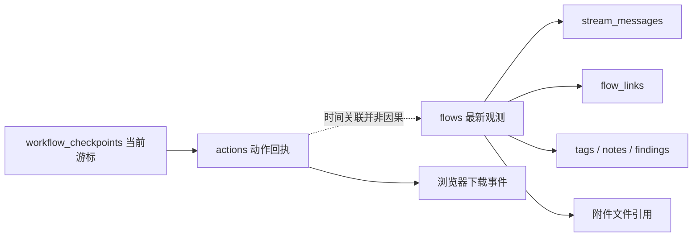
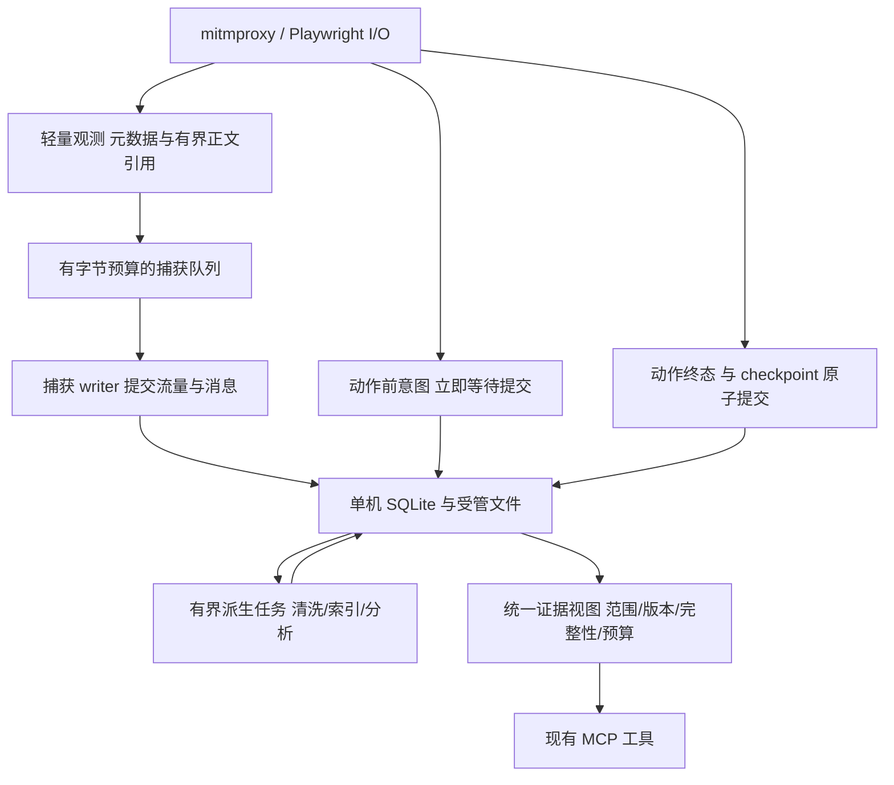

# AgentProxy 流量数据库与内核专项评审

日期：2026-10-25。代码基线：[`cfd617e`](https://github.com/zhanyiyi/AgentProxy/tree/cfd617ee07e3759f2abde3dabde72e2b378c44a5)。本文细化 [AI-native 路线](AI_NATIVE_ROADMAP.md)，不重复扩充已经可组合完成的功能。

**结论：数据库选型、基本分表和内核组件组合正确，但还没有达到成熟的业务证据内核水平。应继续使用 SQLite、mitmproxy 和 Playwright，优先完善证据表示、事务边界、异步终态与资源生命周期。** 暂无数据支持更换数据库、重写代理引擎或建设分布式系统。

本轮读取源码与官方资料；仅在新建的合成库执行一次查询计划观察，未打开已有抓包库、未读取真实正文或凭据、未启动代理/浏览器、未运行产品测试或性能压测。下文不会把静态推断写成已复现故障。

## 1. 当前数据库设计的实际形态

在当前初始化路径中，共有 **8 张业务表、14 个显式索引**；checkpoint 表由 CheckpointStore 延迟创建，另有 SQLite 自动索引和序列表。实查合成库的 `user_version=0`、当前连接 `foreign_keys=0`。仅启用外键 pragma 也不会凭空产生外键约束。[表结构源码][DB]

| 存储 | 当前职责 | 判断 |
|---|---|---|
| `flows` | 请求、响应的最新聚合记录；同 ID UPSERT；头与正文内联 | 用于本地采集合理，但应明确生命周期、版本和正文表示 |
| `stream_messages` | SSE/WS 应用消息，独立追加，自增 ID | 方向正确，连接未结束也能查询；按流游标索引适配实际用途 |
| `actions` | 浏览器动作回执 JSON 与时间 | 与 HTTP 分开合理；异步终态及与 checkpoint 的提交关系需补齐 |
| `workflow_checkpoints` | 每个 context 的当前游标 JSON | 不是任务执行器；应保留现有定位与未决状态语义 |
| `flow_links` | source/target/relation 多边关系 | 足够作为轻量关系存储；字段级来源、边查询与范围需完善 |
| `flow_tags` | 流量标签 | 简洁实用，需避免悬空引用 |
| `flow_notes` | 一条 flow 的结构化调查笔记 | 继续复用；不能替代原始观测 |
| `findings` | 现有派生分析结果，区分 finding/signal | 与捕获事实分表合理；派生失败和版本应可辨别 |
| `*.db.artifacts/` | 捕获附件，单文件限额、hash、临时文件原子替换 | 文件保存方式合理；欠缺整体空间和引用生命周期 |
| `downloads/` | 浏览器下载文件 | 当前最新下载状态主要在内存，跨重启检索与文件保留需统一说明 |

下面是逻辑关系，**不表示当前已经建立 SQL 外键**：

### 应保留的设计

- 一个实例默认一个本地数据库，显式路径才复用历史，符合当前单机 MCP 工具定位。
- HTTP 最新状态与实时应用消息分表，不等待 SSE/WS 关闭后才保存。
- 重复头按有序列表存储，已有截断、省略、字符集和附件 hash 字段。
- WAL、连接确定关闭、异常回滚、checkpoint 的短事务，均是有效基础。
- 采集进入后台队列；动作开始前的意图立即提交。这两种时序需求不同，应保留。
- SQLite 关系表足以承载目前规模的关联查询，没有必要先引入图数据库。

## 2. 数据库最需要补齐的设计

### 2.1 迁移需要成为可重试的原子操作

**当前具体问题：** `_init_db()` 没有显式开启迁移事务，`ALTER TABLE` 捕获所有 OperationalError；旧 findings 迁移先 CREATE `findings_new`，再 INSERT。当前 Python sqlite3 的默认事务行为在 DML 前才隐式开启事务，所以前面的 CREATE 不一定被后续回滚覆盖。中途失败可遗留 `findings_new`，下次启动再次创建时失败。[DB：初始化与迁移](https://github.com/zhanyiyi/AgentProxy/blob/cfd617ee07e3759f2abde3dabde72e2b378c44a5/src/agent_proxy/core/traffic_db.py#L143)

最小设计：

1. 配置 WAL 后，用明确事务执行一次 schema 升级。
2. 使用 `PRAGMA user_version` 标记少量顺序迁移；版本 0 先识别支持的旧 schema。
3. 列是否存在用 schema 查询判断；真正的 I/O、只读、损坏或 SQL 错误向外报告。
4. 对可能已经存在的迁移中间表，根据已知 schema 与内容验证决定恢复方式，不能直接删掉。
5. checkpoint 表也纳入同一 schema 版本管理，仍可保留按需使用。

无需迁移框架。Python 默认 DDL/DML 事务区别见 [官方事务控制](https://docs.python.org/3.12/library/sqlite3.html#transaction-control-via-the-isolation-level-attribute)。当前代码没有使用 executescript；后续也不能假设它自动继承任意外层事务。

对应新增任务 **D01**。一次旧 schema 升级样本加一次中断恢复边界足够，不做反复破坏性测试。

### 2.2 动作回执与检查点完成必须一起提交

当前 `act_browser` 先提交 checkpoint.finish，再调用另一笔事务 save_action。两次提交之间中断，可能留下 completed checkpoint 指向不存在的 action。导航和部分拒绝路径也采用相似顺序。[提交位置](https://github.com/zhanyiyi/AgentProxy/blob/cfd617ee07e3759f2abde3dabde72e2b378c44a5/src/agent_proxy/core/session_manager.py#L175)

开始执行前分配稳定 action_id；完成时，回执与 checkpoint 在同一连接、同一事务内提交。动作前意图仍必须等待提交后才能执行浏览器原语。可以让当前存储方法接受已有事务连接，或增加一个用途明确的 `finish_action` 方法，无需统一成新的异步任务系统。

这会补足 K03/W01 的底层一致性。并非所有写入都必须进采集队列；把动作意图变成“成功入队即可执行”，会削弱当前已有的恢复语义。

### 2.3 数据库保存的是解码后的证据视图

`FlowSnapshot` 读取 mitmproxy 的 `.content`，它已经去掉 Content-Encoding；DB 再按字符集转换为 TEXT，可能替换非法字符并截断。附件同样来自这份解码内容。头里保留的 Content-Encoding、Content-Length 则描述原 HTTP 消息，不能把两者拼起来称为线上原始报文。[快照][WRITER]、[正文存储](https://github.com/zhanyiyi/AgentProxy/blob/cfd617ee07e3759f2abde3dabde72e2b378c44a5/src/agent_proxy/core/traffic_db.py#L325)、[上游 content/raw_content 合同](https://docs.mitmproxy.org/stable/api/mitmproxy/http.html)

还存在方向不对称：响应有 charset、decode_note、omitted，普通请求默认按 UTF-8 处理，没有相同程度的描述；`size` 取解码后的响应长度，流式响应可为 0，不能用它统计线上传输字节。

建议请求和响应共享一个小型正文描述，而不是所有地方重新推断：

| 字段语义 | 目的 |
|---|---|
| representation | 文本投影、解码字节附件、应用消息或未保留 |
| content_encoding / charset | 区分内容编码和字符编码 |
| decode_status / omitted_reason / truncated | 保留完整性和失败事实 |
| observed_bytes / decoded_bytes / stored_bytes | 只填写实际可观测量；不具备 wire 计量时为 unknown |
| content_version / artifact_ref / message_source | 支持来源核验与按需展开 |
| observation_point / modified_by_rule | 说明记录在流量处理链的哪个位置产生 |

不需要默认保存无界原字节，也不用立即把所有正文迁出 SQLite。先把语义和预算说清楚；确有字节级保真需求时，在声明的容量内保存字节附件。

### 2.4 完整性必须贯穿内部读取

数据库已有截断/省略等字段，但 `get_all_for_analysis()` 和 `get_by_ids()` 的返回投影主要保留 body 和 headers，会丢掉这些限制。下游分析无法区分完整 JSON、被截断的 JSON、二进制省略以及正文位于消息表的 SSE。[内部读取](https://github.com/zhanyiyi/AgentProxy/blob/cfd617ee07e3759f2abde3dabde72e2b378c44a5/src/agent_proxy/core/traffic_db.py#L1139)

K10/S01 应从存储读取边界使用同一正文描述，提取、聚合和语义索引继续传递限制。仅在最终 MCP JSON 外包上 completeness 字段不够，因为内部已经丢失的信息无法重新推断。

### 2.5 先定义父记录与引用合同，再补外键

目前 tag/link/note 的写入没有保证 flow 存在；不存在的 ID 也能生成悬空记录。另一方面，队列溢出可能丢掉父 flow 快照但保留子消息，因此给所有表机械加 FK 可能让更多有效消息入库失败。[引用写入](https://github.com/zhanyiyi/AgentProxy/blob/cfd617ee07e3759f2abde3dabde72e2b378c44a5/src/agent_proxy/core/traffic_db.py#L917)

最小顺序：

1. 实时消息首次提交时保证父元数据可见，或明确记录父来源缺失；不依赖队列里另一项一定成功。
2. 对模型主动添加的标签、笔记和关系，在同一事务中验证有效来源与采集代际。
3. 对已确定生命周期的关系再声明外键并逐连接启用；同步调整清理顺序。
4. 历史悬空记录显式列出，不凭空补造源流量，不无提示删除。

外键只能约束关系存在，不能代替来源版本、捕获范围或业务身份判断。见 [SQLite 外键要求](https://www.sqlite.org/foreignkeys.html)。

### 2.6 关系表支持多边，查询也应保留多边

flow_links 的主键包含 relation；但 get_chain 按节点 seen 去重时连输出边也一并跳过，会丢同一节点的另一种关系以及菱形路径。深度最大 5 也不能约束高扇出图的返回量。[chain 查询](https://github.com/zhanyiyi/AgentProxy/blob/cfd617ee07e3759f2abde3dabde72e2b378c44a5/src/agent_proxy/core/traffic_db.py#L971)

保持节点访问去重，输出按 `(source,target,relation)` 去重；附带节点/边预算和 partial。分层批量查边并复用读取连接即可，不必改成图数据库。这里优化的是证据查询完整性，仍然不把关系相连等同业务因果。

### 2.7 磁盘生命周期需要独立于单条限额

256 KiB 正文上限、32 MiB 单附件上限只能约束单项。flow/message 总量、附件和浏览器下载仍可长期增长；clear 保留文件是当前明确行为，却不能释放整个采集占用。附件保存先于 DB 提交，DB 失败后也可能留下无引用文件。[附件保存][ARTIFACT]、[clear](https://github.com/zhanyiyi/AgentProxy/blob/cfd617ee07e3759f2abde3dabde72e2b378c44a5/src/agent_proxy/core/traffic_db.py#L771)

需要提供 DB/WAL/附件/下载总占用、可回收空间与保留状态；配置总容量和保留策略，按 flow 及其消息/引用家族处理。仍在写入、仍被当前步骤引用的记录不能任意裁剪。达到硬预算后明确停止保留相应内容并记录原因，转发与业务执行保持各自合同。

文件引用用简明清单管理，至少知道来源、相对路径、大小、hash、状态；下载异步完成后也要更新最终状态。仅允许清理当前实例管理目录中经过引用核对的文件。SQLite 的 DELETE、WAL checkpoint、VACUUM 是不同操作，不要每次删一条就做全库压缩。

对应新增任务 **D02**。不引入对象存储、自动上传归档或后台无限清理服务。

## 3. 查询和索引：这次有具体观察结果

执行环境为 Python **3.12.10**、SQLite **3.49.1**。一次合成库观察包含 6000 条 flow、6000 条消息，使用真实初始化 schema、执行 ANALYZE，再观察 7 条现有查询形状及 1 条候选查询形状。没有测量吞吐或时延。[完整 SQL 与计划结果](research/database/query-plan-evidence.json)

合成数据：flow 分布于 7 个 `.test` origin，每四条一条 POST，其余 GET；timestamp 每三条重复一次；正文为固定结构的虚构订单 JSON。消息分布于 10 个 flow，每十一条一条 SSE，其余 WS。候选仅在合成库增加 origin 列及一个组合索引，产品 schema 未变。

| 查询 | 本轮实际计划要点 | 正确解释 |
|---|---|---|
| 最近流量列表 | 扫描 `idx_timestamp` | 按时间取得前若干项是合理访问路径；SCAN 不自动等于读完整张表 |
| domain 过滤 | 扫描 `idx_timestamp`，逐项计算 hostname_matches | URL 索引不能直接定位这个 Python 函数谓词，稀疏匹配时成本会增加 |
| method + 时间排序 | 搜索 `idx_method`，另建临时排序 B-tree | 过滤索引存在，但没有同时满足排序 |
| URL/body 子串关键词 | 扫描 `idx_timestamp` | `%keyword%` 需要检查文本；LIMIT 不保证只检查 limit 条 |
| 按 flow 读取消息游标 | `idx_stream_flow(flow_id,id)` 范围搜索 | 当前索引设计到位，应保留 |
| 按 protocol 读取消息游标 | 主键 id 范围搜索后过滤协议 | 可以工作；协议稀疏且查询高频时再考虑 `(protocol,id)` |
| meta 按 ID 查询 | 主键搜索 | 按主键索引定位；当前问题在 SELECT * 加载正文及输出投影，并非缺 ID 索引 |
| 候选 exact origin + method + 时间/ID 排序 | 使用 `(origin,method,timestamp DESC,id DESC)` | 对这一特定形状有效，不代表所有域名/子域查询都适用 |

优化应按真实查询形状选少量索引。候选示例：

- 经常做精确 origin + method 筛选时，考虑上述四列组合。
- 经常仅按 origin 筛选并按时间排序时，需要另评估 `(origin,timestamp,id)`；不能假设中间带 method 的索引总能满足排序。
- host 与 origin 是不同概念：子域范围还需明确匹配方式，不能把精确 origin 条件直接替换原来的子域查询语义。
- keyword 的子串语义与 FTS 分词语义不同，升级全文检索时应明确 mode，不暗中改变调用者预期。
- `idx_flow_links_src` 与关系主键前缀、`idx_findings_flow` 与 UNIQUE 前缀存在重叠，属于检查候选；不先批量删除索引。

计划文本依赖 SQLite 版本和数据分布，只用于审阅，不能把整段输出写进脆弱的断言。依据：[EXPLAIN QUERY PLAN](https://www.sqlite.org/eqp.html)、[索引规划](https://www.sqlite.org/queryplanner.html)、[LIKE 优化条件](https://www.sqlite.org/optoverview.html#the_like_optimization)。

## 4. 写入引擎：保留异步采集，调整实际成本

### 4.1 一个采集 writer 不等于整个库只有一个写入者

流量和消息经过 FlowWriter；checkpoint、动作、标签、笔记等直接打开连接提交。这是当前架构事实，并非所有路径都被单线程串行化。

应明确数据库由一个活动 AgentProxy 实例管理，可以有短生命周期读连接。显式 db_path 是继续历史采集的入口，不等于已支持多个活跃实例共享同一 checkpoint 空间：当前 checkpoint 按 context 为键，初始化会把旧 inflight 调整为 unknown，第二个活动实例可能误处理第一个实例的状态。[checkpoint 初始化](https://github.com/zhanyiyi/AgentProxy/blob/cfd617ee07e3759f2abde3dabde72e2b378c44a5/src/agent_proxy/core/workflow_state.py#L23)

当前产品不需要多人并发写同一任务。K05 应明确活动实例所有权与历史恢复边界，避免把 SQLite 支持多连接当作业务状态支持多实例。

### 4.2 写连接可复用，但批量事务应有边界

每次保存 flow/message 都新建连接、配置 pragma、提交并关闭；当最后一个连接关闭时，WAL 通常进行 checkpoint 和相关文件清理。因而现有短连接路径具有重复建立与回写成本。[连接生命周期](https://github.com/zhanyiyi/AgentProxy/blob/cfd617ee07e3759f2abde3dabde72e2b378c44a5/src/agent_proxy/core/traffic_db.py#L115)、[官方 WAL 行为](https://www.sqlite.org/wal.html)

最小优化候选是：写线程独占一个持续连接，线程结束时关闭；读连接继续短生命周期。连接不跨线程共享。若容量基线证明确有提交瓶颈，再用有条数、字节数和最长等待时间的小批提交，保证开放流消息不会因凑批而长时间不可见。

动作前意图不等待采集凑批；控制操作需要明确屏障。扫描、解压、文件写入等耗时工作不放在长时间持有 SQLite 写锁的事务里。无需连接池或数据库服务进程。

### 4.3 NORMAL 的持久性需要说清

WAL + synchronous=NORMAL 的设计保证原子性、一致性与隔离；应用进程崩溃与系统掉电不是同一保证等级。系统故障可能回退近期已提交事务，不能据此说“数据库一定不一致”。参见 [SQLite 同步级别](https://www.sqlite.org/pragma.html#pragma_synchronous)。

建议为正常业务步骤的执行前意图采用需要的持久性等级：若承诺系统故障后仍保留已接受意图，应在关键动作事务使用 FULL，并等待完成；捕获流量可保留 NORMAL，状态明确显示这一选择。无需整库无差别改 FULL，也无需拆两套数据库。

这仍不构成远端业务的 exactly-once：远端提交与本地 SQLite 无法组成原子事务，unknown 必须保留。

### 4.4 本地 SQLite 版本需要先更新

本轮合成库记录的实际运行时是 SQLite **3.49.1**。SQLite 官方已公布一个罕见的 WAL-reset 问题，修复于 **3.51.3 及以后**，并提供 **3.44.6 / 3.50.7** 回补版本。本地版本不包含这些修复；当前项目确有 WAL 和多连接写入路径，因此 K11 应优先核对实际加载库并采用已修复版本。[官方说明](https://www.sqlite.org/wal.html#walreset)、[3.51.3 发布记录](https://www.sqlite.org/releaselog/3_51_3.html)

这不证明现有数据库发生过损坏。本轮没有复现该问题，也不需要为了升级依赖去复现。`sqlite3` 通常随 Python 运行时或系统库提供，更新普通 PyPI 业务依赖不保证改变实际 SQLite；安装验收应记录 `sqlite3.sqlite_version`。

## 5. 内核引擎：应修复的四个事实边界

### 5.1 解码失败不能让响应元数据消失

普通 HTTP 的快照在代理事件循环读取 `.content`。上游这个属性可能严格解压并抛出 ValueError；当前 submit 捕获异常后 dropped 加一，整份快照丢弃。可能只留下请求记录，而已收到的状态码和响应头都没有保存。[WRITER]

建议先取得稳定的 HTTP 元数据和有界字节引用，正文解码独立形成成功/失败结果；解码失败仍保存响应状态、头和失败原因。同步工作量可控后，再决定哪些操作移到 worker，不能仅在最外层 catch 后假装采集成功。

此外，HTTP error hook 虽会记录 flow，但快照和 schema 没有保存 flow.error，NULL status_code 无法区分 pending 和 failed。应记录 `request_seen / response_headers_seen / complete / failed / interrupted` 等观测生命周期，具体状态名保持少量且稳定；握手早期错误则使用连接级事件。[error hook](https://github.com/zhanyiyi/AgentProxy/blob/cfd617ee07e3759f2abde3dabde72e2b378c44a5/src/agent_proxy/core/mitm_controller.py#L220)

对应 K06/K08/K10，优先级在解压性能优化之前。

### 5.2 派生处理不能伪装成原始捕获完成

writer 保存记录后同步调用 scanner，扫描结束才取下一条；每次 finding 写入又独立开连接和事务。更重要的是 scanner 内部捕获异常并返回计数，add_finding 失败也可返回 False；扫描端仍可能累加计数，writer 的 scan_errors 未必能看到真实失败。[writer](https://github.com/zhanyiyi/AgentProxy/blob/cfd617ee07e3759f2abde3dabde72e2b378c44a5/src/agent_proxy/core/flow_writer.py#L176)、[scanner](https://github.com/zhanyiyi/AgentProxy/blob/cfd617ee07e3759f2abde3dabde72e2b378c44a5/src/agent_proxy/core/passive_scan.py#L36)

先明确派生任务的 success/partial/failed、实际写入数、规则版本和处理范围。语义索引接入时，可复用路线图 S02 的有界派生任务机制，让捕获提交先完成，派生结果允许延期和重建。没有容量数据前，不为此新增复杂优先级调度器或大量 worker。

这里仅优化被动结果的存储真实性与资源隔离，不扩展检测规则或自动测试动作。

### 5.3 对话框处理后，原动作仍需要闭环

当前 act 遇到 dialog 可以返回 pending，原 Playwright task 继续执行；task 的完成回调只写内存事件。dialog 处理后，SessionManager 立即把 checkpoint 设为 ready，没有把原动作最终状态写回同一回执。[动作代码](https://github.com/zhanyiyi/AgentProxy/blob/cfd617ee07e3759f2abde3dabde72e2b378c44a5/src/agent_proxy/core/browser_controller.py#L838)、[dialog 处理](https://github.com/zhanyiyi/AgentProxy/blob/cfd617ee07e3759f2abde3dabde72e2b378c44a5/src/agent_proxy/core/session_manager.py#L239)

最小修正是让现有 task 完成通知携带原 action_id，持久更新同一 receipt/checkpoint；解除对话框只是一个中间事件，不能自动当作原动作完成。流程由模型继续调用既有工具，不加入人工审批、隐藏重放或新编排器。

原 task 仍 pending 时保持未决，释放工作流锁，使再次出现的对话框仍可被处理；不能持锁等待原 task 而阻塞下一次 dialog 调用。迟到通知需匹配采集代际和动作版本，只更新对应结果，不能覆盖已推进的 checkpoint。

下载也有类似的迟到结果：文件完成和 hash 在异步任务中产生；当前内存下载列表与历史动作内的 pending 快照不是同一份最新持久状态。D02 只保存必要的文件终态和引用，不要求把所有浏览器事件全量事件溯源。

### 5.4 记录应说明观察点

recorder 注册在 interceptor 前。请求初始快照在本阶段修改前；响应时的请求快照可能已经包含之前的请求修改，响应快照仍在当前响应修改前；UPSERT 再覆盖之前请求字段。[注册顺序](https://github.com/zhanyiyi/AgentProxy/blob/cfd617ee07e3759f2abde3dabde72e2b378c44a5/src/agent_proxy/core/mitm_controller.py#L331)

这不意味着必须保存两份完整报文，但数据库必须说明观察方向/阶段、是否经过规则变化。否则模型可能把“代理修改前的响应”误认为“浏览器实际收到的响应”。保存必要的修改元数据和来源即可，不扩展改包能力。

## 6. 推荐的最小内核形态

这是对当前模块职责的收敛，不是要求重写架构：

- `TrafficDB` 负责 schema、事务和必要 SQL；把纯正文描述/序列化逻辑收敛成小模块，避免每个消费者自己猜完整性。
- `FlowWriter` 负责捕获队列、提交及错误事实；动作关键提交仍使用独立的立即完成路径。
- `SessionManager` 负责会话与动作边界，不承担语义检索规划。
- 派生处理从已提交事实读取；处理失败不改变捕获事实，也不阻止原始数据查询。
- 模型视图只对已知数据做投影，不能默认触发大规模扫描或向外发送正文。

内联 TEXT/JSON 不必立即全部拆表。适合索引和约束的高频字段放列，例如 origin、状态、版本、来源；不常查询的消息编码细节可继续 JSON。先修 SELECT 投影、提交时序与必要索引，再依据规模决定正文是否物理拆分。

## 7. 纳入任务清单的变更

保留原路线图的任务编号，已有任务补充具体验收，只新增两个此前没有独立覆盖的任务：

| 任务 | 本轮补充 |
|---|---|
| K03 | checkpoint + receipt 原子完成；dialog 后原动作终态持久闭环 |
| K05 | 活动实例所有权、父消息元数据与引用一致性；与清空代际统一 |
| K06 | 普通 HTTP 解码失败仍保留元数据；字节语义和上游内存边界 |
| K07 | 真实查询计划驱动少量索引；写线程连接复用候选；批量提交以测量为准 |
| K08 | HTTP flow 的失败终态与早期连接错误一起覆盖 |
| K10/S01 | 内部分析投影也保留完整性；正文方向、观察点与字节含义一致 |
| K11 | 优先升级本地实际 SQLite 至含官方修复的版本；记录 Python/SQLite 联动 |
| S02 | 被动派生处理与未来索引共用清晰结果语义，避免误报扫描成功 |
| S03/S06 | 多边关系不丢证据，图展开有边数/节点数预算 |
| **D01，P1** | 版本化 schema 与原子、可重试迁移 |
| **D02，P1** | 整库/附件/下载保留、空间计量、引用清理与异步文件终态 |

建议先执行：**K11 的运行时修复核对 → D01 → K03 的提交/终态修复 → K06/K08 的元数据可靠性 → K05/K10 的证据一致性**。K01 输出修复可独立并行。随后处理 K07/D02，再继续语义索引。

低优先级合同项：`:memory:` 当前每次新建并关闭连接，初始化连接关闭后 schema 不会供下一次连接使用；如果不作为支持路径，直接在配置入口明确拒绝，比加一套内存库共享连接机制更简单。[连接实现](https://github.com/zhanyiyi/AgentProxy/blob/cfd617ee07e3759f2abde3dabde72e2b378c44a5/src/agent_proxy/core/traffic_db.py#L126)

## 8. 本轮验证与完成边界

- 静态核对真实表结构、SQL、工具入口、writer、解码和浏览器 task 完成路径。
- 查询计划仅执行一次，使用合成库；当前与候选结果见 [证据 JSON](research/database/query-plan-evidence.json)。没有使用结果推算吞吐倍数。
- SQLite 运行时与官方修复状态已核对；没有执行故障利用或数据库损坏复现，也没有改用户运行环境。
- 没有修改 `src/` 或 `tests/`。这些是开发依据，不能在交付说明中标成问题已经修复。

目前可以肯定的是：框架和存储选型值得保留。真正决定 AgentProxy 能否成为可靠业务工具的，是每个结果都能说明**来自哪里、保存到哪一步、完整到什么程度、是否还可核验**；数据库和内核应围绕这一合同同步收紧。

[DB]: https://github.com/zhanyiyi/AgentProxy/blob/cfd617ee07e3759f2abde3dabde72e2b378c44a5/src/agent_proxy/core/traffic_db.py#L143
[WRITER]: https://github.com/zhanyiyi/AgentProxy/blob/cfd617ee07e3759f2abde3dabde72e2b378c44a5/src/agent_proxy/core/flow_writer.py#L70
[ARTIFACT]: https://github.com/zhanyiyi/AgentProxy/blob/cfd617ee07e3759f2abde3dabde72e2b378c44a5/src/agent_proxy/core/artifact_store.py#L41
